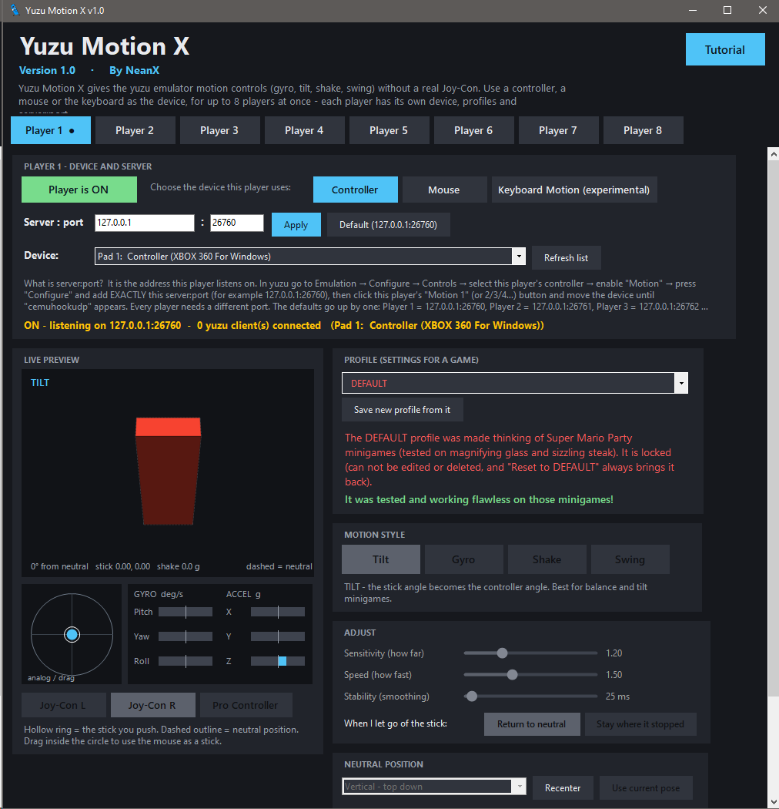

# Yuzu Motion X  -  Version 1.0  -  By NeanX

**What it is for:** Yuzu Motion X gives the yuzu emulator motion controls (gyro, tilt, shake, swing) without a real Joy-Con.
Use a **controller**, a **mouse** or the **keyboard** as the device, for up to **8 players at once**. Every player has its own
device, profiles and server:port. It is the combination of *Yuzu Motion* (controller) and *Yuzu Motion Mouse*, plus the new
experimental **Keyboard Motion**, in one window. Native Windows app (.NET 8), one self-contained `.exe`.
The **Tutorial** button in the app opens this same guide.

## How to Set Up Motion Controls
Follow these steps to get started:

**Step 1 – Open Yuzu Motion X**
- Launch the app on your PC.
- Pick the player tab (Player 1 … Player 8), choose the device (Controller, Mouse or Keyboard Motion) and press **Player is ON**.
- Make sure your device is connected and test that it moves in the live preview (the Test buttons also move it).

**Step 2 – Configure Yuzu**
- Open Yuzu.
- Navigate to Emulation → Configure → Controls.
- Select the controller you want to use.
- Enable the box "Motion".
- Press "Configure".
- Add `127.0.0.1:26761` (example) Server/Port - use the exact server:port shown for that player in Yuzu Motion X.
- Click on "Motion 1" (or 2 / 3 / 4 … depending on the player you are setting).
- Move the device specified until it appears "cemuhookudp".

## Server : port for each player
Every player is its own motion server, so each one needs a different port. You can change them in the player tab; the defaults go up by one:

| Player | Server:port | Player | Server:port |
|---|---|---|---|
| 1 | 127.0.0.1:26760 | 5 | 127.0.0.1:26764 |
| 2 | 127.0.0.1:26761 | 6 | 127.0.0.1:26765 |
| 3 | 127.0.0.1:26762 | 7 | 127.0.0.1:26766 |
| 4 | 127.0.0.1:26763 | 8 | 127.0.0.1:26767 |

The server:port in Yuzu Motion X and in yuzu's Motion configuration must match exactly. Use **Apply** after typing a new address and **Default** to go back to the player's default.

## The window
- **Header**: name, version, author, summary and the **Tutorial** button.
- **Player tabs**: Player 1 … Player 8 (a dot marks players that are ON). Players that are OFF use no ports and no CPU.
- **Inside a tab**: *Player is ON/OFF*, the device type (**Controller / Mouse / Keyboard Motion (experimental)**), the **server:port** boxes with a short explanation, the **Device:** list (the exact physical device, by its full name) and below it the full screen of the chosen device type (live preview, profiles, motion style, sliders, neutral position, tests, Advanced settings).
- Everything is saved next to the .exe in `Yuzu Motion X settings.json` (when you save/delete a profile, switch device, turn a player ON/OFF, apply an address, and on exit).

## The three devices
- **Controller** - an Xbox-style (XInput) pad. In **Device:** pick Pad 1-4, shown with the pad's full name ("Not connected" for empty slots). Other pads work through Steam Input, DS4Windows or x360ce. The controller profiles read the **right stick only**, so the left stick stays free for the game (Advanced settings -> Stick to use can change that).
- **Mouse** - Windows Raw Input on its own thread (works while yuzu has the focus and is never slowed down by the window). **Device:** = *All mice* or one specific mouse, so two players can each use their own mouse. Tilt/Swing: the mouse pushes a spring-loaded virtual stick. Gyro/Shake: mouse speed is the stick.
- **Keyboard Motion (EXPERIMENTAL)**: **Device:** = *All keyboards* or one specific keyboard.
  - Click inside the circle to place a **point**, then press the key you want for it.
  - Holding that key moves the virtual stick towards the point; releasing brings it back. Several keys at once add up.
  - Click a point to open its **submenu**: key, behavior (**Hold** = while pressed, **Toggle** = press to go / press again to return, **Pulse** = a tap goes and returns after the max press time), left/right and up/down position, strength, **time to reach the point**, **time to come back**, **max press time** and smooth start/stop. Drag a point to move it, right-click it to delete it.
  - The hollow ring is the live stick; a point lights up while its key is active.

## Profiles (per player, per device)
The profile list is colour coded: **DEFAULT = red**, profiles made by the program (start with `*`) = **green**, your own = **white**.
- **DEFAULT** - locked: it can't be edited or deleted, and "Reset to DEFAULT" always brings it back. Only "Save new profile from it" is shown, and every setting control is greyed out. If anything ever differs it is put straight back. The Controller DEFAULT is the setting tuned for the Super Mario Party minigames (magnifying glass, sizzling steak). The Mouse and Keyboard DEFAULTs are based on it (their device-specific values are untested; Keyboard Motion is experimental).
- **`*` profiles** - "Save new profile from it" (name box starts as "<name> (mine)") and "Reset to DEFAULT".
- **Your profiles** - "Save Changes", "Save new profile from it", "Delete profile", "Reset to DEFAULT".
- At start-up: no settings file -> DEFAULT everywhere; settings file found -> each device starts in the profile it had when you closed the program.

## Same motion as before
The motion engine is identical to Yuzu Motion and Yuzu Motion Mouse (compared file by file), and the Controller and Mouse DEFAULT values and the mouse-to-stick math are the same as in those apps - so the same movements give the same motion output.

## Tips
- Map Motion 1 AND Motion 2 in yuzu if a game uses either Joy-Con.
- The Test buttons help yuzu detect the device while you map the motion button.
- If a game moves the wrong way, use "Fix wrong motion" in Advanced settings.
- Only one copy of Yuzu Motion X can run at a time (the old Yuzu Motion / Yuzu Motion Mouse apps can still run if you give them different ports - or just use this one instead).

## Get the .exe
**Option A - no installs**: upload this folder to a GitHub repository (keep `.github/workflows/build.yml`), Actions -> "Build Yuzu Motion X" -> Run workflow, download `Yuzu-Motion-X-v1.0-windows` (zip with `Yuzu Motion X v1.0.exe`).
**Option B**: install the .NET 8 SDK and double-click `build.bat`.
